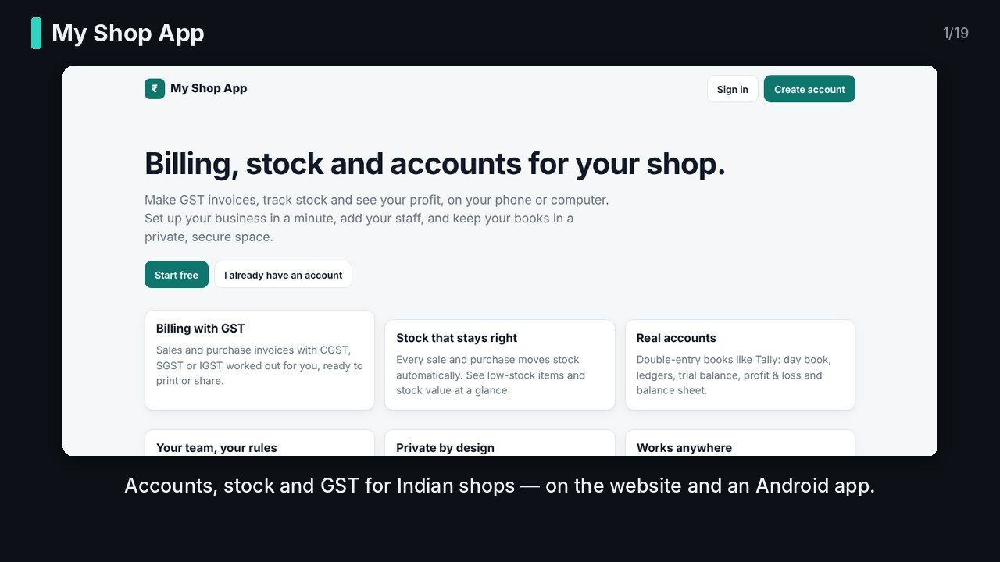
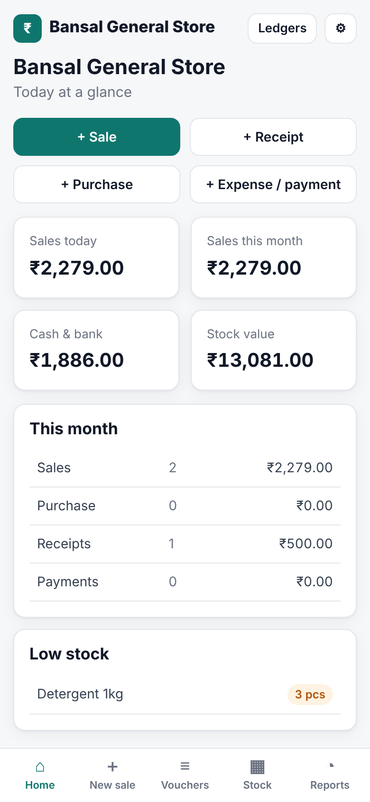

# My Shop App

Tally-style **accounting, inventory and GST billing** for shops: a web app that works on
phones and computers, plus an **Android app** (Expo) in [`mobile/`](mobile/). Anyone can sign up, create their business, invite staff with roles, and
work in a private space isolated at the database level.

**Stack:** Next.js 16 (App Router) · PostgreSQL 14+ with Row-Level Security · `pg` · zod · Tesseract · Node 20+ · Expo SDK 58 (Android).

## Feature tour (2 minutes)

[](docs/video/my-shop-app-tour.mp4)

**[▶ Watch the tour (MP4, 2 min, with subtitles)](docs/video/my-shop-app-tour.mp4)**: billing, phone use, invoices,
bill scanning, stock, CSV import, reports, payment reminders, team roles, security and the optional AI summary.
It uses real screenshots of the app; the screens may look a little different as the design changes.
Subtitles are burned in and also included as [`my-shop-app-tour.srt`](docs/video/my-shop-app-tour.srt).



## Features
Full checklist: [docs/FEATURES.md](docs/FEATURES.md). Privacy and encryption: [docs/DATA_PROTECTION.md](docs/DATA_PROTECTION.md).

- Sign up / sign in, multiple businesses per user, invite staff (owner, admin, accountant, cashier, viewer)
- Chart of accounts seeded like Tally (groups and ledgers), customers and suppliers with GSTIN/state
- Stock items with units, HSN, GST rate, prices, reorder level, opening stock; stock adjustments and physical counts
- **Import** items and customers/suppliers from CSV; **export** reports to CSV and the whole business as a JSON backup
- One person can run **one or many firms**, each with separate books; overview of all firms
- Vouchers: Sales, Purchase, Receipt, Payment, Contra, Journal, Credit Note, Debit Note — double entry,
  always balanced, gap-free numbering per financial year, cancel (never delete)
- GST: CGST+SGST or IGST by place of supply, round-off, printable tax invoice
- Reports: Day Book, Ledger, Trial Balance, Profit & Loss, Balance Sheet, Stock Summary, GST Summary,
  Receivables / Payables, dashboard
- **Scan supplier invoices** (OCR on the phone or on the server) into reviewed purchase entries
- **Optional AI shop summaries** in English/Hindi/Hinglish with a local LLM (Ollama, LM Studio) or Groq/OpenRouter/Grok
- Email: account confirmation, password reset, invitations (SMTP or Resend)
- **Notifications** (cancelled bills, low stock, new members, daily summary) and **payment reminders** by WhatsApp/SMS/email with your UPI ID
- Item photos and logos (sharp, CDN-ready); optional Kafka event stream
- Audit log of every change; one REST API for the website and the Android app

## Run it on your computer

Needs **Node 20+** and **PostgreSQL** (or Docker).

```bash
git clone https://github.com/VaibhavBansa1/my-shop-app.git
cd my-shop-app
npm install
```

Start Postgres (skip if you already have one; then set `SUPERUSER_URL`):

```bash
docker compose up -d
```

Create the database roles, dev/test databases and run migrations:

```bash
npm run db:setup
```

Start the app and open http://localhost:3000:

```bash
npm run dev
```

To open it from your phone on the same Wi-Fi, use `http://<your-PC-IP>:3000` and add that to
`APP_ORIGIN` in `.env.local` (comma-separated), e.g. `APP_ORIGIN=http://localhost:3000,http://192.168.1.20:3000`.

## Tests

```bash
npm test
```

Runs unit tests and integration tests against the `shop_test` database **as the real app role**
(tenant isolation, voucher rules, reports, members, auth). With the app running:

```bash
npm run smoke
```

## Android app
See [docs/MOBILE.md](docs/MOBILE.md). In short: `cd mobile && npm install && npx expo run:android`.

## Documentation
- [docs/GLOSSARY.md](docs/GLOSSARY.md) — every title and keyword explained (also in the app at /help)
- [docs/FIELDS.md](docs/FIELDS.md) — every field: required or optional, and why
- [docs/PERFORMANCE.md](docs/PERFORMANCE.md) — scale test results
- [docs/ARCHITECTURE.md](docs/ARCHITECTURE.md) — system design, requirements, trade-offs
- [docs/DATABASE.md](docs/DATABASE.md) — every table and rule
- [docs/SECURITY.md](docs/SECURITY.md) — threat model and controls
- [docs/API.md](docs/API.md) — REST API for web and native apps
- [docs/adr/](docs/adr/) — architecture decision records
- [docs/MOBILE.md](docs/MOBILE.md) — Android app: run, build, security
- [docs/OCR.md](docs/OCR.md) — invoice scanning
- [docs/AI.md](docs/AI.md) — connecting Ollama / LM Studio / Groq / OpenRouter
- [docs/EMAIL.md](docs/EMAIL.md) — email providers and account verification
- [docs/NOTIFICATIONS.md](docs/NOTIFICATIONS.md) — alerts, daily summary, payment reminders
- [docs/OPERATIONS.md](docs/OPERATIONS.md) — telemetry, feature flags, security log, Redis, worker, Docker, Kubernetes
- [docs/MANUAL_TESTING.md](docs/MANUAL_TESTING.md) — checklist for manual testing and owner decisions
- [docs/HANDOFF.md](docs/HANDOFF.md) — current status and what to build next

## Deploying
Docker: `docker compose -f docker-compose.prod.yml --env-file .env.production up -d --build` (see docs/OPERATIONS.md).
Kubernetes: `deploy/k8s` (see its README).

Any Node host plus managed Postgres. Set `DATABASE_URL` (shop_app role), `DATABASE_OWNER_URL`
(for migrations only), `APP_ORIGIN=https://your-domain`, `NODE_ENV=production`, and `TRUST_PROXY=1`
if behind a proxy/load balancer. **Set `DATA_ENCRYPTION_KEY`** (keep a copy safe). Configure email (docs/EMAIL.md) and optionally AI (docs/AI.md);
every setting is explained in `.env.example`.
Run `npm run db:migrate` on each deploy, then `npm run build && npm start`, and schedule
`npm run db:cleanup` daily.
